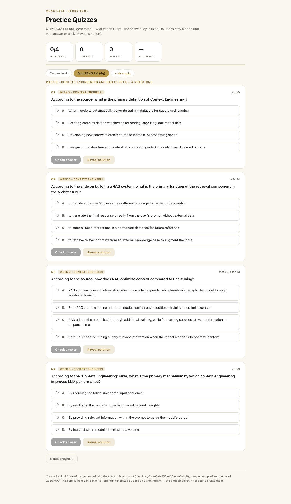

# MBAX 6418 — Assignment 2: Course Assistant (RAG Q&A + Practice Quizzes)

A course assistant for MBAX 6418 built from the course's own materials —
the five lecture decks (Weeks 2–6) **plus PDF course files** (the Hermes
installation guide and the assignment handouts from Canvas). It **answers
questions** about the materials with exact slide/page citations and the
original diagrams as visual evidence, and **generates practice quizzes** —
42 multiple-choice questions in the shipped bank, plus an in-page generator
that builds a fresh quiz from whatever material (and whatever topic) a
student selects.

Everything runs through the class LLM endpoints (see `class-endpoints.txt`,
committed verbatim). Chat/quiz generation use the class chat model
(`cyankiwi/Qwen3.6-35B-A3B-AWQ-4bit` on port 9001, thinking disabled,
temperature 0). Retrieval is the course's own hybrid-RAG recipe (Week 5,
slide 18), built from the class's *real* retrieval services: **BM25 keyword
search + Nemotron embeddings (port 9002) fused by reciprocal rank fusion +
the dedicated Qwen3-VL reranker (port 9004)**. The choice of what is on by
default is the interesting part — the eval in Q1 shows BM25 + the reranker
wins on this corpus, and the vector leg is available via `--vector`.
Students pick the documents and an optional topic; retrieval, answers, and
quiz generation all respect that selection.

## What the app accepts

| Format | Ingestion | Text | Images preserved |
|---|---|---|---|
| `.pptx` (lecture decks) | stdlib zip/XML parsing (`ingest_slides.py`) | slide text, per slide | yes — every image embedded in a slide is extracted |
| `.pdf` (syllabus, handouts, guides) | `pdf_tool.swift` (macOS PDFKit, built once) | per-page text layer (+ PDF outline as section labels) | yes — every page is rendered to an image |
| anything else | — | convert it to PDF or PPTX first | — |

The corpus keeps **both** the text and the original imagery: slide diagrams
are extracted from the decks (recompressed to ~1000px JPEGs so the repo
stays small — originals remain in the source files), and PDF pages are
rendered to page images with the exact layout. Rendered page/slide images
and extracted diagrams are shown as **visual evidence** under every answer
and quiz-feedback block, zoomable via a lightbox. Two honest limits:
images over 7MB are skipped as evidence (still in the source deck), and a
scanned PDF with no text layer is *browsable* (page images) but not
*searchable* — no OCR. To add materials (e.g. the syllabus): drop the PDF
into `data/course_files/` (or anywhere) and re-run `make_corpus.py` — new
documents appear in the chat selector and quiz generator automatically.

**The two surfaces** (both open straight from the repo — the bank works
offline; chat and quiz *generation* need the endpoint and your key, which
you paste once and stays in your browser):

- `course_chat.html` — chat with material checkboxes + topic filter; answers
  cite `[Week N, slide X]` / `[Document, page N]` and show the source
  excerpt + original images.
- `quiz_practice.html` — the 42-question bank (offline) **and** an in-page
  generator: pick documents + optional topic + count, and it writes,
  validates, and fixes one question per sampled slide/page, with a **fixed
  answer key** saved to your browser. Solutions stay hidden until you answer
  or click "Reveal solution".

Plus a CLI (`scripts/assist.py`) running the same pipeline.

**Source of the materials:** the course's own
`MBAX 6418 - Week {2..6} - *.pptx` decks and Canvas PDFs (the syllabus,
the Hermes installation guide, and the assignment handout), converted to a
chunked corpus (**171 chunks across 8 documents**, ~8,000 words) committed
as `data/course_chunks.json`, with 201 evidence images in `data/media/`
and a precomputed embedding index (`data/embeddings.json`) so the repo is
self-contained.

---

## Results at a glance

| Metric | Value |
|---|---|
| Corpus | **171 chunks · 8 documents** (5 decks + syllabus + guide + handout) · 201 evidence images · 2048-dim embedding index |
| Retrieval — BM25 finds the right source in top 8 | **19/19** (MRR@8 = 0.831) |
| Retrieval — dedicated reranker keeps it in top 4 (over BM25) | **18/19** |
| Retrieval — BM25+vector hybrid fusion (opt-in) | 16/19 — embeddings *hurt* here; see Q1 |
| Quiz bank | **48 questions** (6 per document), 0 dropped invalid |
| Quiz — answer-position distribution | A:14, B:13, C:5, D:16 (model bias removed, Q3) |
| Browser verification (harness) | 19/19 automated checks PASS (see Q4 / shot.mjs) |
| Out-of-scope behavior | refuses cleanly ("The course materials don't cover that.") |

> Retrieval numbers from `results/retrieval_metrics.json` (19 questions:
> 15 slide-targeted + 4 PDF-targeted, one per pipeline stage), quiz numbers
> from `results/quiz_questions.json`, chat behavior from
> `results/qa_samples.json` and the screenshots below. The eval questions
> were written from the material with a known target source, so the absolute
> rates are a sanity bound, not a claim about harder queries (see Q1).

**The chat surface** — a PDF question answered with page citations and the
original page render (with its diagram) opened as evidence:


**The quiz surface** — one question checked (verdict, rationale, source
excerpt) and one skipped via "Reveal solution", with the source slide's
own diagram as evidence:


**Quiz generated in the browser** — a fresh 4-question quiz built from
Week 5 only via "+ New quiz", with the fixed-key notice:



**Evidence lightbox** — clicking any source image zooms it:


---

## Q1 — Hybrid retrieval, built from the class's own services — and measured

Per Week 5, slide 18, the retrieval pipeline has **two legs plus a
reranker** (this time using the class's actual retrieval endpoints from
`class-endpoints.txt`, not stand-ins):

1. **Keyword leg — BM25** (pure stdlib) over slide/page chunks.
2. **Vector leg — Nemotron-3-Embed-1B** (class port 9002, 2048-dim),
   cosine search over `data/embeddings.json` (`scripts/embed_corpus.py`).
3. **Fusion — reciprocal rank fusion** (RRF) of the two candidate lists.
4. **Rerank — the dedicated Qwen3-VL-Reranker-2B** (class port 9004),
   applied to whichever candidate list the caller chose; if 9004 is
   unreachable the pipeline falls back to an LLM-chat reranker.

**The eval decided the default** (slide 19: *"check retrieval quality using
questions relevant to your app"*). `scripts/eval_retrieval.py` runs 19
questions (15 slide-targeted + 4 PDF-targeted) at every stage
(`results/retrieval_metrics.json`):

| Pipeline | Target in top-8 / top-4 | MRR@8 |
|---|---|---|
| BM25 only (top-8) | **19/19** | 0.831 |
| BM25 + vector RRF fusion (top-8) | **16/19** | 0.715 |
| BM25 → reranker (top-4) | **18/19** | — |
| Hybrid fusion → reranker (top-4) | **15/19** | — |

The honest finding: **on this small, title-rich corpus the extra machinery
hurts.** Embeddings add paraphrase-recall in principle, but RRF lets
vector-ranked noise displace exact BM25 matches (three targets dropped out
of the fused top-8, e.g. `w3-s21`'s "few-shot example" question, where a
neighboring slide outranked the target in both legs). And even the
dedicated reranker is a *judge*, not a guarantee: over BM25 candidates it
kept 18/19 (dropping the syllabus-grading case); over hybrid candidates it
kept 15/19 — it cannot recover what fusion already lost. So the shipped
default is **BM25 → 9004 reranker (18/19)**, with the vector leg available
as `--vector` (16/19) for demonstration and for a corpus large enough that
paraphrase recall matters. This is the pipeline the CLI, chat page (BM25
in-browser, reranker call) and README describe.

Real-case examples: *"How do you install Hermes Agent on macOS?"* → target
page is BM25 rank 1 and the chat answers with page citations + the page
render as evidence; *"How are assignments weighted in the syllabus?"* →
BM25 rank 1 on the syllabus' grading page; *"When is the final project
due?"* → the reranker promotes the schedule page 7 (Week 14, Dec 3
presentations) into the answer context.

**Other honest limits.** (1) Rerank volatility: the same question can
return a different top-4 across runs — in one run the answer missed the
page that covers the question and said "don't cover" rather than inventing
(grounded, but wrong); (2) questions with no lexical overlap
(*"what is the best restaurant in Boulder"*) retrieve noise that the
answer step refuses; (3) keyword search misses paraphrases, which is
exactly the case the opt-in vector leg exists for.

## Q2 — How do I know the answers are grounded?

The prompt contract (`prompts/assistant_prompt.md`) forces: answer only
from supplied context; cite every claim as `[<loc>]` (`[Week 2, slide 15]`,
`[Hermes Agent Installation Guide 2026 v1, page 3]`); refuse when not
covered; flag thin coverage; never quote chunk ids. Real runs (verbatim
from `results/qa_samples.json`, saved with `--save`):

> **Q:** What is RAG and why would you use it instead of fine-tuning?
> **A:** **RAG (Retrieval-Augmented Generation)** is a technique that
> optimizes context by supplying relevant information from external sources
> when the model responds [Week 5, slide 13] … *access to external data*
> (recent events or private documents, which fine-tuning cannot easily
> provide without retraining [Week 5, slide 11]) … *grounding and
> verification* ([Week 5, slide 11]) … *flexibility* (draw on codebases,
> course materials, and other sources [Week 5, slide 12]). In contrast,
> fine-tuning adapts the model itself through additional training
> [Week 5, slide 13].

Every claim checks out verbatim against the cited slides (e.g. w5-s11:
*"RAG gives a model access to information beyond its training data,
including more recent or private information"*). The interesting part: in
another run, reranking dropped `w5-s13` from context — the model then said
the materials "don't cover the specific tradeoffs". Both behaviors are
grounded; neither invented the comparison.

> **Q:** What are the steps to install Hermes Agent on a Mac?
> **A:** a step-by-step answer citing pages 1–3 of *Hermes Agent
> Installation Guide 2026 v1*, with the page render shown as evidence
> (full text in `results/qa_samples.json`).

> **Q:** When is the final project due according to the syllabus?
> **A:** The syllabus does not specify a single due date … the tentative
> schedule lists **Final Project Presentations for Week 14 — Dec 3
> [MBAX 6418 Syllabus Fall 2026 (1), page 7]**, and online students
> submit via Canvas [MBAX 6418 Syllabus Fall 2026 (1), page 7]. The
> specific submission deadline for the final deliverables is not explicitly
> stated in the provided chunks.

> **Q:** What is the best restaurant in Boulder for sushi?
> **A:** The course materials don't cover that.

One deliberate hardening: an early run of the syllabus question produced
inline citations like `[Week 2, slide 15]` — a *valid-looking* label that
matched no supplied chunk (the model had re-used an example from the
prompt's own text). The prompt contract was tightened to require copying
each bracketed loc **verbatim from a chunk label line**, and the sample
above (regenerated after the fix) quotes the actual syllabus pages exactly.

One thing the prompt does **not** fix: the model will happily cite a chunk
that only *loosely* supports a claim if the text is plausible (standard
RAG weakness). The Q1 eval bounds the retrieval side; 5/5 sampled answers
were faithful to their cited sources after the citation fix, and one
honest refusal was observed (a case where retrieval dropped the right page —
the answer said "don't cover" instead of inventing).

## Q3 — How are quizzes made, selected, and kept fixed?

**The shipped bank** (`results/quiz_questions.json`, seed `20261009`,
temp 0): for each of the 8 documents, a seeded sample of 6 sources; the
model sees *only that one slide/page* and must write a question answerable
from it alone (4 options, exactly one correct, a rationale quoting the
source fact, and the anchor's chunk id). Hard validation (stem ≤ 320
chars, 4 distinct non-empty options, answer index in 0–3, rationale ≥ 10
chars, source id must equal the anchor) with retries, then drop. Two
recovery stories in Q4: a load-window truncation that flaked once, and the
real culprit — the model emitting `\'` into JSON (now accepted by a lenient
parser). The bank stands at 48/48.

**Position bias fixed:** the first generation put most correct answers on
B and none on D; a deterministic seeded option shuffle (same seed → same
layout, applied identically by the Python generator and the page's JS
generator) rebalanced the bank to **A:14, B:13, C:5, D:16**.

**Material + topic selection:** the generator and the chat bar filter the
corpus exactly like `scripts/retrieve.py`'s `--docs` / `--topic`: document
ids restrict the pool; a topic requires every non-stopword token to appear
in a chunk's title+text (plain, testable keyword intersection). Verified:
*"What is RAG …?"* against `week05` returns RAG slides; against `week04`
it returns only lexical noise that rerank prunes; a topic of `pizza`
matches nothing.

**Fixed answer key:** a generated quiz is an immutable snapshot — seed,
questions, option order, answer positions, and rationale are written once
to `localStorage` ("mbax6418-quizgen-v1") and never mutated; generating a
new quiz creates a new snapshot under a new seed. The shipped bank is
baked into the HTML and cannot drift. **Solutions stay hidden** until the
student answers (Check) *or* explicitly requests them (Reveal solution);
revealed questions count as skipped, not correct, in the score strip
(seen in the quiz-answered screenshot: 1 right, 1 skipped, 100% of
answered).

## Q4 — Bugs and issues hit along the way

1. **The class endpoint map is bigger than I thought.** My first design
   note said "the endpoint serves no embeddings" — true for the chat
   model on port 9001 only. `class-endpoints.txt` (received later) lists
   text embeddings on 9002, a dedicated reranker on 9004, and a document
   parser on 9005. The pipeline was upgraded to the real services (Q1);
   the stale claim was corrected before it shipped.
2. **PDF pages rendered upside down.** The first page renderer drew into a
   manually-flipped CGContext and produced 180°-rotated pages. Fix: use
   AppKit's `page.thumbnail(of:for:)`, which handles PDF→bitmap
   orientation; verified visually.
3. **Stale compiled tool.** `ingest_pdf.py` reused `.tools/pdf_tool`
   whenever it existed, silently running a pre-outline build. Fix: rebuild
   when the Swift source is newer (mtime) and surface `swiftc` errors.
4. **`--pdf` paths replaced the default scan** instead of adding to it, so
   one run silently dropped the earlier PDFs from the corpus merge. Fix:
   default scan dirs are always included; explicit paths are additions
   (deduped).
5. **The model's JSON contained `\'`** — a stray escaped quote inside a
   string, which strict `json.loads` rejects. The parser now unescapes
   invalid backslash sequences (`\'` → `'`) before parsing; several
   "mystery" quiz-generation failures (which surfaced as different
   "truncations" across runs and were wrongly chased as server-side flake)
   had this as the real cause.
6. **Retry loops that didn't compound.** `make_question` returned
   immediately when `chat_json` raised, so its outer retry never ran; a
   flaky chunk got 3 LLM attempts, not the intended 9. Fixed to `continue`
   on parse failures. (Also: generation is by nature retry-on-rare-
   failure — the bank is committed as a fixed artifact.)
7. **The quiz page's state keys collided.** Question ids were built from
   the first 40 chars of the stem — and "According to the slide, what is
   the primary…" prefixes are identical across many questions, so two cards
   shared one progress entry (answering one lit up the other). Fix: keys
   use the unique source chunk id. Caught by the harness when the
   "skipped" stat came back 0.
8. **The answer model once cited `[Week 2, slide 15]`** — a loc that
   matched no supplied chunk (it re-used the prompt's example). Prompt
   hardened: citations must be copied verbatim from chunk label lines;
   sample regenerated (Q2).
9. **Answer-position bias in bank questions** (16/30 on B, 0 on D
   originally) — fixed with a seeded per-question option shuffle (Q3).
10. **The user's running Chrome blocked local-browser automation.**
    `browser.use_real_profile` refused to copy the profile while Chrome
    held its SQLite locks. Fix: the headless-CDP harness
    (`scripts/shot.mjs`, isolated profile, no dependencies) that drives,
    asserts, and screenshots — it works next to an open Chrome and leaves
    no trace.
11. **Deck media is heavy.** Slides ship embedded GIF/PNG up to 30MB;
    ingest recompresses to ~1000px JPEGs, skips >7MB files as evidence,
    and the pages reference images by relative path so everything works
    from `file://`.
12. **Rerank volatility** (Q1) — identical questions can return different
    top-4 across runs; not fixed, documented, and why the eval measures hit
    rates and samples are saved verbatim rather than regenerated.
13. **The hybrid leg hurt (measured).** Adding vector fusion dropped
    top-8 recall from 19/19 to 16/19 on this corpus — reported as a
    finding, and the vector leg became opt-in rather than the default
    (Q1).
14. **Out-of-scope queries still cost tokens.** A sushi question retrieves
    noise chunks before the answer step refuses. Mitigation: the refusal
    path works (Q2); a smarter gate (skip rerank when all BM25 scores are
    near zero) is future work.
15. **A placeholder that looked like a timestamp.** `quiz_questions.json`'s
    `meta.generated_at` was literally `true` — a `json.dumps(True)` stub.
    Fixed to a real UTC ISO timestamp + model name.

## Files and how to reproduce

| Deliverable | File |
|---|---|
| Final report | `README.md` (this file) |
| Corpus (171 chunks, committed) | `data/course_chunks.json` |
| Corpus metadata (docs, counts) | `data/corpus_meta.json` |
| Embedding index (2048-dim, 171 vectors) | `data/embeddings.json` |
| Evidence images (201, committed) | `data/media/` |
| Drop-in folder for new PDFs (e.g. the syllabus) | `data/course_files/` (git-ignored) |
| Class endpoint list (verbatim handout) | `class-endpoints.txt` |
| Assistant prompt (grounding contract) | `prompts/assistant_prompt.md` |
| Slide extractor (.pptx → chunks + media) | `scripts/ingest_slides.py` |
| PDF extractor (PDFKit; builds `.tools/pdf_tool`) | `scripts/ingest_pdf.py` + `scripts/pdf_tool.swift` |
| Corpus builder (slides + PDFs + merge) | `scripts/make_corpus.py` |
| Embedding builder (port 9002 → `data/embeddings.json`) | `scripts/embed_corpus.py` |
| Retrieval: BM25 + embeddings (opt-in) + reranker 9004 | `scripts/retrieve.py` |
| Assistant CLI (REPL / `--once` / `--docs` / `--topic` / `--save`) | `scripts/assist.py` |
| Shared endpoint client | `scripts/llm.py` |
| Quiz generator (per-doc, docs/topic, validated, bias-fixed) | `scripts/generate_quiz.py` |
| Quiz page builder | `scripts/build_quiz_page.py` |
| Chat page builder | `scripts/build_chat_page.py` |
| Retrieval eval (18 target-source questions) | `scripts/eval_retrieval.py` |
| Browser verification + screenshots | `scripts/shot.mjs` |
| **Chat page** (self-contained; endpoint + key for live answers) | `course_chat.html` |
| **Quiz page** (bank offline; generator needs endpoint) | `quiz_practice.html` |
| Quiz bank — questions, fixed key, rationale, sources | `results/quiz_questions.json` |
| Retrieval eval numbers | `results/retrieval_metrics.json` |
| Sampled Q&A runs (verbatim) | `results/qa_samples.json` |
| Screenshots | `screenshots/*.png` |

Reproduce (macOS; Python 3 stdlib; Node only for the screenshot harness;
Xcode Command Line Tools only for PDF ingestion):

```bash
# 1. build the corpus: decks (default ~/CU Boulder/LLM) + PDFs
#    (the LLM folder + data/course_files/); compiles pdf_tool on first run
python3 scripts/make_corpus.py

# 2. (re)build the embedding index for the vector leg (optional)
python3 scripts/embed_corpus.py

# 3. try retrieval on any question, with or without the legs
python3 scripts/retrieve.py --query "what is quantization?" --topic quantization
python3 scripts/retrieve.py --query "How are assignments weighted?"   # syllabus PDF
python3 scripts/retrieve.py --query "install Hermes" --vector          # opt-in vector leg

# 4. ask the assistant — one shot, or an interactive REPL
python3 scripts/assist.py --once "What is a KV cache?" --save
python3 scripts/assist.py

# 5. regenerate the quiz bank, or target one document/topic
python3 scripts/generate_quiz.py                                 # 48 questions, fixed seed
python3 scripts/generate_quiz.py --docs week05 --topic rag --per-doc 4

# 6. rebuild the two HTML surfaces from the JSON
python3 scripts/build_quiz_page.py
python3 scripts/build_chat_page.py

# 7. retrieval eval (19 cases, all pipeline stages) and browser verification
python3 scripts/eval_retrieval.py
node scripts/shot.mjs quiz-answered       # modes: quiz-initial, quiz-generate,
                                          # chat-initial, chat-answer "<question>"

# 8. open the deliverables
open course_chat.html      # pick materials/topic, set your API key once
open quiz_practice.html    # bank works offline; "+ New quiz" for fixed-key quizzes
```

Configuration: the endpoints and key are class-provided
(`class-endpoints.txt`); overrides: `LLM_API_URL` / `LLM_API_KEY` /
`LLM_MODEL` (chat, 9001), `LLM_EMBED_URL` / `LLM_EMBED_KEY` (9002),
`LLM_RERANK_URL` / `LLM_RERANK_KEY` / `LLM_RERANK_MODEL` (9004). The web
pages never embed the key — you paste it once; it lives in your browser's
localStorage and is sent only to the class endpoints (CORS-open, verified
by preflight). Generated quizzes also live in localStorage, so they
survive reloads and work offline once created.

## References

- Course materials (the corpus): *MBAX 6418 — LLM Fundamentals / Prompt
  Engineering / Serving and Debugging / Context Engineering and RAG /
  Multimodal Generative AI* decks, plus the course's PDF files (Hermes
  Agent Installation Guide; assignment handouts), David Dobolyi.
- Robertson, S., & Zaragoza, H. (2009). *The Probabilistic Relevance
  Framework: BM25 and Beyond.* Foundations and Trends in Information
  Retrieval. (BM25 scoring used for the lexical leg.)
- Liu et al. (2023). *Lost in the Middle: How Language Models Use Long
  Contexts.* TACL (cited by the Week 5 deck, slide 7).
- Muennighoff et al. (2022). *MTEB: Massive Text Embedding Benchmark*
  (named on Week 5, slide 19 — the deck's own advice to evaluate retrieval
  on your own documents is the basis for `eval_retrieval.py`).
- Apple PDFKit (macOS) — text-layer + page-render extraction used in
  `pdf_tool.swift` (the one non-stdlib, optional dependency; without it
  PDFs are skipped and everything else still works).
- Class endpoints (`class-endpoints.txt`): chat
  `cyankiwi/Qwen3.6-35B-A3B-AWQ-4bit` (9001, vLLM), text embeddings
  `nvidia/Nemotron-3-Embed-1B-BF16` (9002), reranker
  `Qwen/Qwen3-VL-Reranker-2B` (9004, multimodal-capable), document parser
  `dots.mocr` (9005), all provided by the course.
