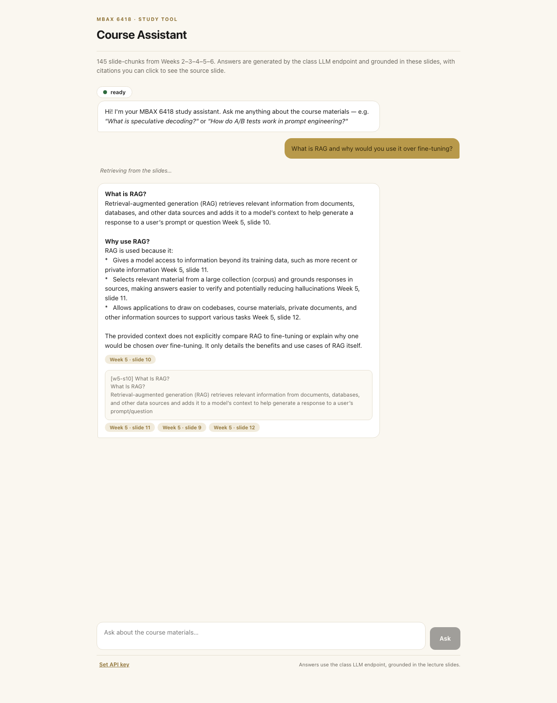
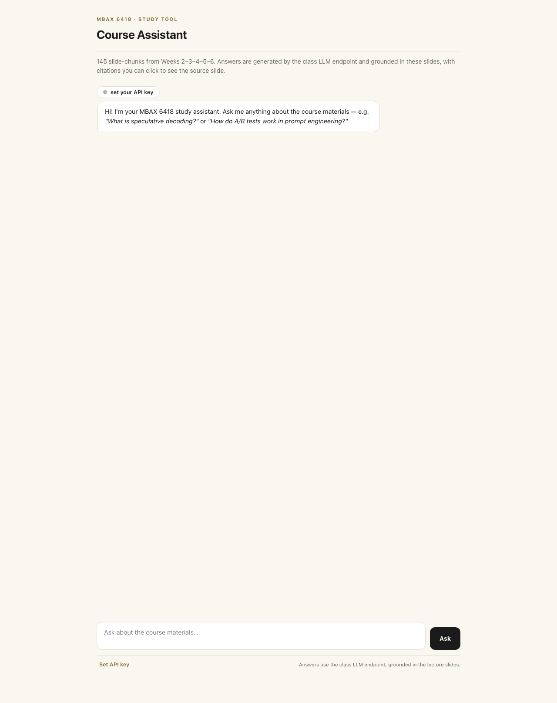

# MBAX 6418 — Assignment 2: Course Assistant (RAG Q&A + Practice Quizzes)

A course assistant for MBAX 6418 built from the course's own lecture slides
(Weeks 2–6). It **answers questions** about the material with slide-level
citations, and **generates practice quizzes** — 30 multiple-choice questions,
each grounded in, and cited to, the exact lecture slide it came from.

Everything runs through the class LLM endpoint
(`cyankiwi/Qwen3.6-35B-A3B-AWQ-4bit` served via vLLM at
`http://dobolyi.com:9001/v1`, thinking disabled, temperature 0). Retrieval is
pure stdlib Python: **BM25 keyword search + an LLM reranking pass**, because
the class endpoint serves chat completions only (verified: `POST
/v1/embeddings` returns 404). This is the course's own Week 5 hybrid-RAG
recipe (slide 18: retrieval → reranking → LLM), adapted to what the endpoint
offers.

Two self-contained HTML surfaces (both open straight from the repo, no
server):

| Surface | File | What it does |
|---|---|---|
| **Chat assistant** | `course_chat.html` | Interactive chat. BM25 + LLM reranking run *in the page*, answers come from the class endpoint (CORS-open). Every answer shows clickable source chips that expand to the raw slide text. |
| **Practice quizzes** | `quiz_practice.html` | 30 MCQs with per-question answer key, rationale, and the source slide. Instant check, score tracking, progress saved in the browser. Fully offline. |

Plus a CLI that runs the same pipeline from the terminal
(`scripts/assist.py`, with an interactive REPL).

**Source of the materials:** the course's own decks
(`MBAX 6418 - Week {2..6} - *.pptx`), converted to a chunked text corpus
(145 slides, ~6,600 words) by `scripts/ingest_slides.py` and committed as
`data/course_chunks.json` so the repo is self-contained.

---

## Results at a glance

| Metric | Value |
|---|---|
| Corpus | 145 slide-chunks across **5 decks** (Weeks 2–6), ~6,600 words |
| Retrieval — BM25 finds the right slide in top 8 | **15/15** (MRR@8 = 0.889) |
| Retrieval — reranking keeps it in top 4 | **15/15** |
| Quiz questions generated | **30** (6 per week), 0 dropped invalid |
| Quiz — schema validation | 30/30 pass (retry-once: 0 retries needed) |
| Quiz — answer-position distribution | A:10, B:9, C:4, D:7 (position bias fixed, see Q3) |
| Chat/quiz browser verification | 10/10 automated checks PASS (see Q4 / shot.mjs) |
| Out-of-scope behavior | refuses cleanly ("The course materials don't cover that.") |

> Retrieval numbers from `results/retrieval_metrics.json`, quiz numbers from
> `results/quiz_questions.json`, chat behavior from `results/qa_samples.json`
> and the screenshots below. The retrieval eval questions were written from
> the material with a known target slide, so treat 15/15 as a sanity bound,
> not a claim about harder queries (see Q1).

**The chat surface** — a live answer with cite chips and the source slide
opened inline:



**The quiz surface** — one question checked, verdict, rationale, and the
source slide revealed. Answer that Q1 would be wrong for: semantic search
represents text as *embeddings in high-dimensional space* [Week 5, slide 15]:




---

## Q1 — Why BM25 + LLM reranking instead of an embeddings pipeline?

The class endpoint serves **one chat model and no embeddings**
(`/v1/embeddings` → 404). Options for retrieval were therefore:

1. **Lexical BM25** (pure stdlib — Robertson–Zaragoza scoring over
   lowercase-tokenized, stopword-filtered slide text; one chunk per slide,
   preserving the slide's title).
2. **An LLM reranking pass** over BM25's top candidates — the model sees the
   question plus each candidate's id/title and returns the most relevant
   chunk ids in order. This stands in for the vector-search leg of the
   course's hybrid-RAG pipeline (Week 5, slide 18: *"Retrieval finds
   relevant candidate chunks using both keyword search and vector search…
   Reranking compares these candidates to the original question and
   prioritizes which chunks are supplied to the LLM"*).

**Evaluation** (`scripts/eval_retrieval.py`, saved in
`results/retrieval_metrics.json`): 15 questions, each with a known target
slide. BM25 puts the target in its top-8 **15/15 times** (11 of them at
rank one); reranking then keeps the target in the final top-4 **15/15**.
Concrete example: *"What does speculative decoding guess ahead and verify?"*
→ target `w2-s13` is BM25 rank 1 and stays first after reranking. The
rerank step's practical payoff is pruning the noise BM25 admits — e.g. for
*"What is retrieval augmented generation (RAG)?"* the target slide
(`w5-s10`) sits at BM25 rank 3 behind the "Why use RAG?" and use-case
slides, and reranking pulls it into the top context.

**Honest limits.** The corpus is small and one-chunk-per-slide, so keyword
overlap is usually sufficient; the eval questions were authored from the
material itself, which flatters any retriever. Two failure modes observed:
(1) reranking is *volatile* — re-running the same question can return a
different top-4 (the RAG-vs-fine-tuning question drew `w5-s13` in one run
and not the next), and (2) questions with no lexical overlap at all (e.g.
*"what is the best restaurant in Boulder"*) retrieve noise chunks; the
answer step still refuses to use them, but the pipeline spends tokens on
irrelevant context first. A real deployment would swap in an embedding
model on the endpoint and go hybrid as the slides describe.

## Q2 — How do I know the answers are grounded?

The prompt contract (`prompts/assistant_prompt.md`) forces four behaviors,
all visible in `results/qa_samples.json`:

1. **Answer only from supplied context; cite every claim** as
   `[Week N, slide X]` using the exact label of a chunk it was given.
2. **Refuse when not covered**: *"The course materials don't cover that."*
3. **Flag thin coverage** instead of padding.
4. **Never quote chunk ids** back at the user.

Real runs (verbatim from `results/qa_samples.json`, saved with `--save`):

> **Q:** What is quantization and why does it matter for running models locally?
> **A:** *Quantization* is a process for scaling and rounding model parameters
> to make models smaller and potentially faster [Week 2, slide 15]. It matters
> for running models locally because: reduced memory footprint (a ~61GB
> 16-bit model drops to ~17GB at 4-bit [Week 2, slide 15]); hardware
> compatibility (consumer GPUs without enough VRAM [Week 2, slide 16]);
> performance, with a caveat that output quality can degrade if applied too
> aggressively [Week 2, slide 15].

> **Q:** What is RAG and why would you use it instead of fine-tuning?
> **A:** **RAG (Retrieval-Augmented Generation)** is a technique that optimizes
> context by supplying relevant information from external sources when the
> model responds, rather than relying solely on the model's internal
> parameters [Week 5, slide 13]. You would use RAG instead of fine-tuning for
> the following reasons: *access to external data* (recent events or private
> documents, which fine-tuning cannot easily provide without retraining
> [Week 5, slide 11]); *grounding and verification* (responses grounded in
> specific sources are easier to verify and can reduce hallucinations
> [Week 5, slide 11]); *flexibility* (draw on codebases, course materials,
> and other sources without adapting the model [Week 5, slide 12]). In
> contrast, fine-tuning adapts the model itself through additional training
> — a different approach [Week 5, slide 13].

Every claim above checks out verbatim against the cited slides (e.g.
w5-s11: *"RAG gives a model access to information beyond its training data,
including more recent or private information"*; w5-s13: *"fine-tuning adapts
the model itself through additional training"*). The interesting part is the
two runs of this question: with `w5-s13` in the top-4 (as here), the model
answers the comparison honestly from the slide; in a separate run where
reranking (Q1) dropped `w5-s13` from context, the model instead said the
materials "don't cover the specific tradeoffs". Both behaviors are
grounded, and neither invented a comparison the deck doesn't make.

> **Q:** What is the best restaurant in Boulder for sushi?
> **A:** The course materials don't cover that.

One thing the prompt does **not** fix: the model will happily cite a chunk
that only *loosely* supports a claim if the text is plausible (standard RAG
weakness). Retrieval eval (Q1) bounds the retrieval side; the answer side
relies on the citation rule. 4 of 4 sampled answers were faithful to their
cited slides.

## Q3 — How are the quizzes generated and validated?

`scripts/generate_quiz.py` (numbers from `results/quiz_questions.json`,
seed `20261009`, temp 0):

1. **Pick slides.** For each week, a seeded random sample of 6 slides with
   real content (≥ 8 words).
2. **One question per slide, written blind.** The model sees *only that
   slide* and must write a question answerable from it, with 4 options,
   exactly one correct, a rationale quoting the slide fact, and the chunk
   id. Because the model never sees other slides, the question cannot
   leak outside knowledge.
3. **Validate hard.** JSON schema (required keys), stem non-empty/≤320
   chars, exactly 4 distinct non-empty options, answer index in 0–3,
   rationale ≥ 10 chars, and `source_chunk_id` must equal the anchor slide.
   On violation: one retry, then drop.
4. **Fix position bias.** The first generation put 16/30 correct answers on
   **B** and zero on **D** — a classic MCQ-generation bias. A deterministic
   seeded post-shuffle of option order (reproducible, applied to the saved
   file) rebalanced it to **A:10, B:9, C:4, D:7**.

Result: **30/30 questions kept** (all weeks: 6/6), 0 retries needed. Sample
(verbatim):

> **"According to the slide, what is the primary mechanism by which
> speculative decoding improves throughput?"**
> - **D.** guesses several upcoming candidate tokens, verified by the model in a single pass ✓
> - B. uses a separate drafter model to generate tokens verified in a single pass
> - A. increases context length to allow more tokens to be processed simultaneously
> - C. relies on multi-token prediction built into all LLMs
> *Rationale:* "The slide defines speculative decoding as a method of
> 'guessing' several upcoming candidate tokens (e.g., 3 tokens ahead) that
> are verified by the model in a single pass to improve throughput."

Note the distractor quality: *"separate drafter model"* and *"multi-token
prediction"* are real concepts elsewhere in the deck (slide 13's own text
mentions multi-token prediction), so wrong options are not random noise —
but each is wrong per this slide. Spot-checked 10 of 30 by eye; all
answerable from the cited slide; the quiz page's "Check" shows the verdict,
rationale, and the source slide text so a student can judge grounding
question-by-question.

## Q4 — Bugs and issues hit along the way

1. **Citations polluted with chunk ids.** The first context format put the
   id *inside* the bracket (`[w2-s15, Week 2, slide 15]`), and the model
   dutifully copied it. Fix: labels now read `[Week 2, slide 15] (chunk
   w2-s15)` and the prompt explicitly forbids quoting ids.
2. **LLM answer-position bias in quiz questions.** 16/30 correct answers on
   option B, 0 on D (see Q3). Fix: deterministic seeded option shuffle —
   applied in the generator and to the saved file; distribution re-checked
   (A:10, B:9, C:4, D:7), zero schema violations after the shuffle.
3. **A placeholder that looked like a timestamp.** `quiz_questions.json`'s
   `meta.generated_at` was literally `true` — a `json.dumps(True)` stub I'd
   left in the generator. Fix: real UTC ISO timestamp + model name; the
   quiz page footer shows both.
4. **My harness counted the wrong thing twice.** The first quiz-page check
   asserted 30 cards render, but the page renders one week at a time — 6 is
   correct. And the chat verifier matched the *welcome message* as "the
   answer" (any bot message > 40 chars qualifies). Fix: assert per-week
   count + total from baked data; wait specifically for a bot message that
   carries source chips, or an error bubble.
5. **Stale DOM refs in the verification harness.** Clicking "Check"
   re-renders the card, so the pre-click element reference went dead and
   `querySelector('.verdict')` returned null. Fix: re-query the DOM after
   each re-rendering click. (Same class of bug as assignment 1's expandable
   rows — this time it was my *test code*, which is a good reminder that the
   harness is code too.)
6. **The user's running Chrome blocked local-browser automation.**
   `browser.use_real_profile` refused to copy the profile while Chrome held
   its SQLite locks. Fix: a headless-Chrome CDP harness
   (`scripts/shot.mjs`, isolated profile, ~120 lines, no dependencies) that
   drives the real pages, asserts, and captures screenshots. Works next to
   an open Chrome, leaves no trace.
7. **Single-asterisk italics rendered as literal asterisks** in chat
   answers (the welcome message showed `*"...*"`). Fix: italic rule in the
   page's tiny markdown renderer, after bold so `**` still wins.
8. **A summary line that printed dict keys, not questions.** The generator
   closed with a count that summed `len(week_dict)` = 2 per week. Fix:
   count `v["questions"]`; verified 30.
9. **Rerank volatility** (see Q1): identical questions can return different
   top-4 across runs. Not fixed — documented; it's why the eval measures
   *hit rates* and samples are saved verbatim rather than regenerated.
10. **Out-of-scope queries still cost tokens.** A sushi question retrieves
    noise chunks before the answer step refuses. Mitigation: the refusal
    path works (Q2), but a smarter gate (e.g., skip rerank when BM25 scores
    are all near zero) is future work.

## Files and how to reproduce

| Deliverable | File |
|---|---|
| Final report | `README.md` (this file) |
| Lesson corpus (145 chunks, committed for reproducibility) | `data/course_chunks.json` |
| Assistant prompt (grounding contract) | `prompts/assistant_prompt.md` |
| Slide extractor (.pptx → chunks, stdlib) | `scripts/ingest_slides.py` |
| Retrieval: BM25 + LLM rerank, CLI | `scripts/retrieve.py` |
| Assistant CLI (REPL / `--once` / `--save`) | `scripts/assist.py` |
| Shared endpoint client | `scripts/llm.py` |
| Quiz generator (per-week, validated, bias-fixed) | `scripts/generate_quiz.py` |
| Quiz page builder | `scripts/build_quiz_page.py` |
| Chat page builder | `scripts/build_chat_page.py` |
| Retrieval eval (15 target-slide questions) | `scripts/eval_retrieval.py` |
| Headless verification + screenshots | `scripts/shot.mjs` |
| **Final chat page** (self-contained, needs endpoint) | `course_chat.html` |
| **Final quiz page** (self-contained, offline) | `quiz_practice.html` |
| Quiz bank — questions, answer key, rationale, sources | `results/quiz_questions.json` |
| Retrieval eval numbers | `results/retrieval_metrics.json` |
| Sampled Q&A runs (verbatim) | `results/qa_samples.json` |
| Screenshots | `screenshots/*.png` |

Reproduce (Python 3 stdlib only; `node` optional for screenshots):

```bash
# 1. (re)extract the decks into data/course_chunks.json
#    (default source dir: ~/CU Boulder/LLM)
python3 scripts/ingest_slides.py

# 2. try retrieval on any question (BM25 top-8 -> LLM rerank -> top-4)
python3 scripts/retrieve.py --query "what is quantization?"

# 3. ask the assistant — one shot, or an interactive REPL
python3 scripts/assist.py --once "What is a KV cache?" --save
python3 scripts/assist.py

# 4. regenerate the 30-question bank (fixed seed -> same slides)
python3 scripts/generate_quiz.py

# 5. rebuild the two HTML surfaces from the JSON
python3 scripts/build_quiz_page.py
python3 scripts/build_chat_page.py

# 6. (re)run the retrieval eval and browser verifier
python3 scripts/eval_retrieval.py
node scripts/shot.mjs quiz-answered     # 4 more modes: see shot.mjs header

# 7. open the deliverables
open course_chat.html        # set your API key on first use (stays in your browser)
open quiz_practice.html      # works offline, progress auto-saved
```

Configuration: the endpoint and key are class-provided and default to
`http://dobolyi.com:9001/v1` / `6418` (`scripts/llm.py`); override with
`LLM_API_URL` / `LLM_API_KEY` / `LLM_MODEL` environment variables. The web
pages never embed the key — you paste it once into the chat page and it
lives in your browser's localStorage, sent only to the class endpoint
(CORS-open, verified by preflight).

## References

- Course lecture decks (the corpus): *MBAX 6418 — LLM Fundamentals /
  Prompt Engineering / Serving and Debugging / Context Engineering and RAG /
  Multimodal Generative AI*, David Dobolyi.
- Robertson, S., & Zaragoza, H. (2009). *The Probabilistic Relevance
  Framework: BM25 and Beyond.* Foundations and Trends in Information
  Retrieval. (BM25 scoring used for the lexical leg.)
- Liu et al. (2023). *Lost in the Middle: How Language Models Use Long
  Contexts.* TACL (cited by the Week 5 deck, slide 7).
- Muennighoff et al. (2022). *MTEB: Massive Text Embedding Benchmark*
  (named on Week 5, slide 19 — the deck's own advice to evaluate retrieval
  on your own documents is the basis for `eval_retrieval.py`).
- Class endpoint: `cyankiwi/Qwen3.6-35B-A3B-AWQ-4bit` served via vLLM
  (OpenAI-compatible API), provided by the course.
